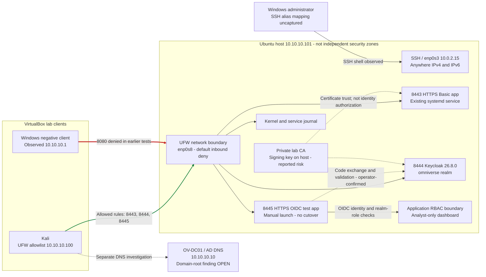
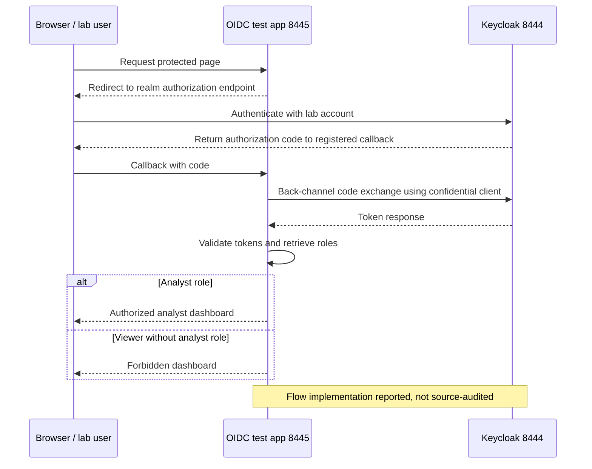
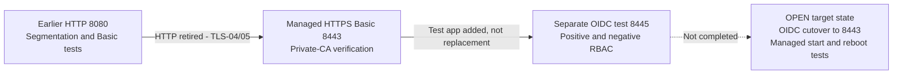

# Architecture and Data Flows

**Current logical reconstruction, not an exported VirtualBox topology or a claim of production readiness.** Diagrams separate the managed 8443 Basic service from the manually launched 8445 OIDC test app. Edges describe observed or operator-confirmed flows; they do not establish untested reachability.

## Network and Enforcement Boundaries

8080 is retired in TLS-04/05. No fresh Windows negative tests are present for 8443/8444/8445; rule configuration must not be substituted for end-to-end denial testing. The CA-to-service lines express trust/certificate use, not a running network connection. HTTPS certificate validation for the 8445 test app and its back-channel trust configuration need dedicated evidence.

Keycloak is co-located with the application host. IAM-06 shows a wildcard 8444 listener, not a lab-IP-only bind. Client restrictions are shown in UFW, but management/other-interface exposure requires review. AD/DNS is not demonstrated as Keycloak federation; lab accounts and roles do not prove AD integration.

## OIDC Authorization-Code Data Flow

Initial client evidence shows openid-connect, publicClient=false and standardFlowEnabled=true, with an 8443 callback. IAM-09 reports a test callback registered but does not display its value. The operator confirms successful authorization-code login on 8445. The diagram explains that reported flow; screenshots alone do not prove code exchange, signature/issuer/audience/expiry checks, state/nonce enforcement, PKCE or replay rejection. Do not publish authorization codes, cookies, client secrets or raw tokens to fill that gap.

IAM-11 shows an authorized dashboard, not an analyst username or numeric HTTP status. IAM-12 shows ov-viewer and realm roles; IAM-13 shows Forbidden. The operator identifies the positive user as ov-analyst and negative status as 403.

## Service Evolution and Operational Boundaries

REC-01/02/03 validate the earlier 8080 stop/start and negative remote checks only. They do not demonstrate recovery of HTTPS, Keycloak or the OIDC test deployment. SEG-10 and AUTH-01 corroborate earlier boot chronology; the manual OIDC app has no persistence evidence. Runtime network addresses do not substitute for a sanitized stored network configuration.

## Threat Model

| Threat | Demonstrated layer | Residual risk |
| --- | --- | --- |
| Non-approved source probes the app | UFW denial and correlated logs for earlier 8080 path | Updated-port, IPv6 and other-interface denial tests missing |
| Network observer captures earlier Basic traffic | CA-verified HTTPS on 8443 and 8080 retirement | Historical exposure may warrant credential rotation; CA lifecycle and key isolation incomplete |
| Authenticated viewer accesses analyst content | Separate test-app role decision and denied page | Role-change propagation, route coverage and bypass testing not established |
| Stolen/forged/replayed token or compromised session | Operator reports token validation | Source review and adversarial token/session tests missing |
| App/IdP host compromise | None fully demonstrated for this scenario | Co-located CA signing key, IdP and workloads concentrate trust |
| Restart/reboot removes OIDC availability | Earlier managed-service recovery only | Test app manual; cutover, restart and reboot validation unfinished |
| DNS dependency behaves unexpectedly | Investigation and retained records | DNS-001 open; no full DNS closure |

This lab demonstrates host-based microsegmentation, TLS and application identity/RBAC controls, not full enterprise Zero Trust. Network location is not proof of trusted identity/device; no MFA, device posture, continuous evaluation, high availability or enterprise federation is demonstrated. See [NIST SP 800-207](https://csrc.nist.gov/pubs/sp/800/207/final) and [Keycloak OIDC documentation](https://www.keycloak.org/securing-apps/oidc-layers) for conceptual context, not proof of implementation.

See [validation](../Reports/Test-Validation-Report.md), [findings](../Findings/REGISTER.md) and [missing evidence](../Reports/Missing-Evidence.md).

## Package Evidence Correlation

Both supplied packages map to existing images and change no deployment boundary. Historical AUTH/REC captures remain the HTTP/Basic 8080 stage; 8443 remains managed HTTPS/Basic; Keycloak is 8444 and the manual OIDC test app is 8445. The second ZIP confirms the existing historical stop/start and TLS captures, not OIDC cutover, current-stack recovery or reboot persistence. Its AUTH-01 label is an HTTP 000 startup diagnostic; the separate log/401 capture supplies primary AUTH-01. See [package reconciliation](../Reports/Package-Reconciliation.md).
