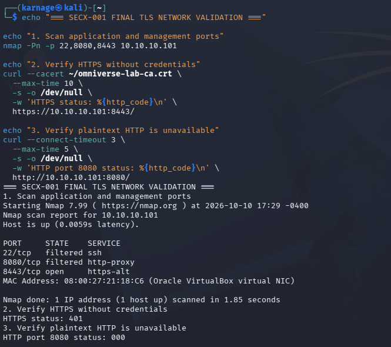
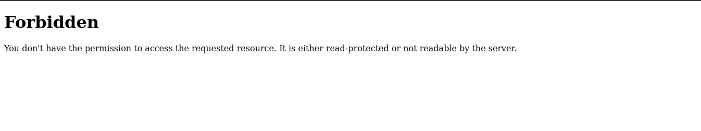

# SEC-008 - Enterprise Security Architecture & Zero Trust

> OmniVerse Enterprise Engineering Portfolio | Architecture and implementation case study

Former project name: **SECX-001**. This case study is now **SEC-008**; historical screenshots, source-package names and VM identifiers retain their original names. See the [naming record](PROJECT-NAMING.md).

[Back to Portfolio](https://github.com/KSWISHA9) | [Technical Report](Reports/Final-Technical-Report.md) | [Architecture](Architecture/Architecture.md) | [Evidence](Evidence/INDEX.md) | [Open Findings](Findings/REGISTER.md)

## Executive Summary

Designed and validated layered security for an internal application in a VirtualBox lab: source-restricted host firewall rules, application authentication, private-CA HTTPS, and Keycloak OIDC role-based authorization. The case study follows the application from unrestricted HTTP access to an analyst-only dashboard with documented permitted and rejected requests.

**Completed scope:** an evidence-backed architecture lab milestone. **Open scope:** managed OIDC cutover, operational hardening and further validation. This demonstrates host-based microsegmentation and local application identity controls, not a complete enterprise Zero Trust deployment.

## Project Snapshot

| Metric | Scope |
| --- | --- |
| Lab systems | Windows Server AD/DNS, Ubuntu Server and Kali Linux; Windows host supports the lab |
| Preserved screenshots | 73, including troubleshooting and historical evidence |
| Implementation stages | Segmentation, Basic authentication, HTTPS, Keycloak/OIDC and application RBAC |
| Current OIDC endpoint | Test port 8445; manually launched |
| Release status | Public case study; engineering work in progress. [Release record](Reports/Release-Record.md) |

## Business Request

A simulated internal engineering application needed a smaller attack surface, protected transport and role-limited access. The design separates three questions: **Can this client reach the application? Can this user authenticate? Is this user authorized for this function?**

The deliverable is a traceable implementation story, including investigation, recovery history and the limitations that must be addressed before wider deployment.

## Problems Investigated and Addressed

### 1. Unrestricted Application Reachability

- **Problem:** The initial HTTP application did not have a documented client-specific network boundary.
- **Investigation:** Compared baseline connectivity, application listeners and UFW policy, then examined blocked-traffic logs.
- **Solution:** Applied default-deny inbound rules with source-IP and port-specific exceptions.
- **Validation and outcome:** Approved Kali access and historical Windows TCP denial demonstrated host-based segmentation. [Segmentation evidence](Evidence/Segmentation/INDEX.md) records the tests; equivalent negative testing on current TLS/OIDC ports remains pending.

### 2. Unprotected Application Transport

- **Problem:** The earlier application used HTTP; Basic authentication alone did not protect credentials in transit.
- **Investigation:** Checked application endpoints, certificate trust and remote HTTP/HTTPS responses.
- **Solution:** Deployed private-lab-CA HTTPS and retired the earlier HTTP endpoint on 8080.
- **Validation and outcome:** Remote CA-verified HTTPS on 8443 returned the expected unauthenticated 401, while 8080 was filtered. [Transport validation](Evidence/TLS/TLS-05-Remote-HTTP-Retirement-Validation.png) supports this result; CA signing-key separation remains open.

### 3. Authentication Without a Demonstrated Role Boundary

- **Problem:** The earlier Basic application did not demonstrate separate analyst and viewer authorization.
- **Investigation:** Examined Keycloak identity/realm-role results and compared protected-dashboard responses for the two roles.
- **Solution:** Implemented an OIDC authorization-code test application with an analyst-only dashboard.
- **Validation and outcome:** The analyst was accepted and the viewer was forbidden on the 8445 test deployment. [IAM evidence and qualifications](Evidence/INDEX.md) distinguish screenshots from operator-confirmed identity/status details. Production cutover to 8443 and managed OIDC reboot persistence remain incomplete.

These are demonstrated improvements within staged lab tests, not blanket closure of the [remaining findings](Findings/REGISTER.md).

## Evidence Gallery

### 1. Protected Transport and HTTP Retirement

Kali reaches HTTPS on 8443 using the lab CA and receives the expected unauthenticated 401. The earlier HTTP port 8080 is filtered and returns HTTP 000. This is transport/challenge evidence, not authenticated-content validation.

### 2. Analyst Dashboard - Authorized

The protected dashboard displays an authorized result. The named `ov-analyst` identity and 8445 endpoint are operator-confirmed; the cropped image does not show them together.

### 3. Viewer Dashboard - Forbidden

The dashboard rejects the viewer request. [Viewer identity and roles](Evidence/IAM/IAM-12-Viewer-Identity-and-Realm-Roles.png) provide the companion evidence; the numeric HTTP 403 is operator-confirmed.

[Browse all evidence and result qualifications](Evidence/INDEX.md)

## Architecture and Deployment

| Boundary / endpoint | Implemented role | Current limitation |
| --- | --- | --- |
| Ubuntu UFW | Default-deny inbound; source-IP and port-specific exceptions | Host-based enforcement, not separate VLANs or device assurance |
| 8080 | Earlier HTTP Basic app | Retired during the TLS phase; recovery evidence is historical |
| 8443 | Systemd-managed HTTPS Basic app | OIDC has not replaced this service |
| 8444 | Keycloak 26.8.0 HTTPS identity provider | Co-located with the application; management/database hardening needs review |
| 8445 | OIDC authorization-code test app | Manual launch; no managed cutover or reboot-persistence proof |
| OV-DC01 | Active Directory and DNS dependency | Domain-root DNS discrepancy remains open |

[Network boundaries and OIDC data-flow diagrams](Architecture/Architecture.md) distinguish observed flows, operator-confirmed implementation and untested paths. AD federation into Keycloak is not claimed.

## Before and After

| Area | Earlier state | Demonstrated later state |
| --- | --- | --- |
| Application reachability | Unrestricted lab HTTP application | UFW source/port restrictions; historical Windows TCP denial |
| Authentication | Earlier unprotected HTTP phase | Basic credential acceptance/rejection on the historical HTTP app |
| Transport | Plain HTTP | CA-verified HTTPS; earlier HTTP endpoint retired |
| Authorization | No documented application role boundary | Analyst dashboard accepted; viewer request forbidden in the OIDC test deployment |
| Operations | Manually hosted application | Managed earlier/Basic application service; OIDC test app remains manual |
| Investigation | Ad hoc connectivity tests | Firewall denial logging and source/destination/port correlation |

These are staged lab results, not a claim that every later control was tested on every endpoint.

## Skills Demonstrated

- Host-based microsegmentation and least-privilege network access.
- Private-CA HTTPS deployment and remote trust validation.
- Keycloak realm, client and role configuration; OIDC authentication/authorization separation.
- Positive/negative application RBAC testing and firewall-log investigation.
- Linux service management, historical outage/restart validation and evidence-driven troubleshooting.
- Architecture, risk communication and technical reporting.

## Documentation

| Start Here | Supporting Detail |
| --- | --- |
| [Final Technical Report](Reports/Final-Technical-Report.md) | Objective, environment, implementation and business impact |
| [Test and Validation Report](Reports/Test-Validation-Report.md) | Expected/actual results and evidence boundaries |
| [Control Matrix](Reports/Security-Control-Matrix.md) | Conceptual NIST mappings, not compliance findings |
| [Findings Register](Findings/REGISTER.md) | Open findings and closure criteria |
| [Before/After Comparison](Reports/Before-After-Comparison.md) | Full implementation chronology |
| [Lessons Learned](Reports/Lessons-Learned.md) | Engineering decisions and limitations |
| [Interview and Resume Summary](Reports/Interview-and-Resume.md) | STAR explanation and scoped project bullets |
| [Missing Evidence](Reports/Missing-Evidence.md) | Tests and artifacts not yet demonstrated |
| [Readiness Checklist](Reports/Readiness-Checklist.md) | Next-phase engineering and release gates |
| [Publication Review](Reports/Publication-Review.md) | Screenshot holds, provenance and approval requirements |
| [Package Reconciliation](Reports/Package-Reconciliation.md) | Hash-based evidence organization |
| [Preserved History](Reports/History/INDEX.md) | Earlier documentation retained without rewriting history |

## Remaining Work and Release Status

OIDC production-port cutover, managed restart/reboot behavior, token/session validation, signing-key separation, DNS closure, current-stack recovery and current-port negative tests remain open. Recovery screenshots cover the earlier 8080 Basic app, not restoration of the current OIDC stack.

AUTH-03 and REC-03 remain supporting negative-authentication/recovery evidence; TRB-02 remains archived troubleshooting, not successful-login evidence. The owner confirmed their visible rejected strings are deliberately fake and approved retaining the originals. They are not featured in this gallery. See [screenshot decisions](Reports/Publication-Review.md) and the [approved release scope](Reports/Release-Record.md).

No VM changes or new control tests are introduced by publication. Original application source is not imported; [Scripts status](Scripts/README.md) records that gap. This is an in-progress case study, not a production-ready deployment. Hands-on work is paused until Monday, October 12, 2026.

## Related Portfolio Work

- [SEC-001 - Microsoft Sentinel SOC Engineering](https://github.com/KSWISHA9/SEC-001-Enterprise-SOC-Engineering)
- [SEC-002 - Enterprise Vulnerability Management](https://github.com/KSWISHA9/SEC-002-Enterprise-Vulnerability-Management)
- [IAM-004 - Conditional Access & Zero Trust](https://github.com/KSWISHA9/IAM-004-Conditional-Access-Zero-Trust)

Created by **Keshawn Lynch**.
